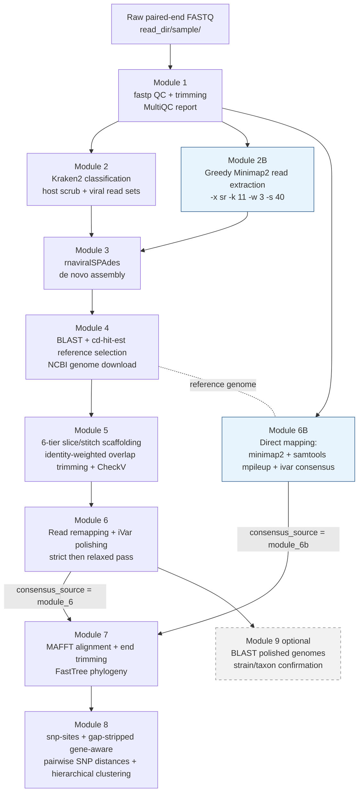

# ViralGenomeEpi


**An end-to-end, config-driven pipeline for viral genome recovery and transmission-level epidemiological analysis from metagenomic next-generation sequencing (mNGS) and amplicon data — spanning raw-read QC to gene-aware SNP-based transmission clustering.**

Adapted from the workflow published at [pubmed.ncbi.nlm.nih.gov/40313286](https://pubmed.ncbi.nlm.nih.gov/40313286/); the pipeline has been validated against that study's sequencing data by reproducing the reported viral linkages.

---

## Overview

`ViralGenomeEpi` reconstructs near-complete viral genomes from clinical sequencing data — supporting both untargeted shotgun mNGS and targeted amplicon designs — and carries them through to epidemiological inference. Starting from raw paired-end FASTQ reads, the pipeline performs quality control, taxonomic classification and host scrubbing, *de novo* assembly, automated reference selection, reference-guided scaffolding, consensus polishing, multiple sequence alignment, phylogenetic inference, and finally **gene-aware pairwise SNP distance calculation with hierarchical transmission clustering**.

The pipeline is organized as a sequence of independent, config-driven modules (Modules 1–9, plus the alternative branches 2B and 6B) located in [`pipeline/operational/`](pipeline/operational). Each module reads a single Python configuration file (`--config`) and writes versioned, per-sample outputs to `<output_dir>/module_N/`, making every stage individually re-runnable and auditable.

> **Status**: This is a research pipeline, not a turnkey package. The config-driven **operational pipeline** in [`pipeline/operational/`](pipeline/operational) is the supported version; the original hardcoded scripts are retained in [`pipeline/basic/`](pipeline/basic) for reference only.

---

## Key Features

- **Dual-pathway consensus generation.** Genomes can be built *de novo* (Kraken2 read subsetting → rnaviralSPAdes assembly → reference-guided scaffolding → iVar polishing; Modules 2 → 3 → 4 → 5 → 6) **or** by direct reference mapping (greedy read extraction → `samtools mpileup | ivar consensus`; Modules 2B → 6B) for low-complexity or low-titer samples where assembly fails. Module 7 selects between the two with a single `consensus_source` toggle.
- **6-tier Minimap2 hybrid scaffolding fallback (Module 5).** Three alignment stringency modes (`conserved` `-c -x asm5`; `divergent_70` and `divergent_60` with `-k 14 -w 5`) are crossed with two reconstruction techniques — single-contig **slicing** and multi-contig **stitching** — with acceptance thresholds of ≥98% reference coverage and ≤5% Ns (slice) or ≤2% Ns (stitch). Overlapping contig boundaries are resolved by **identity-weighted trimming**, which prevents sequence duplication at stitch junctions.
- **Gene-aware, gap-stripped SNP distance calculation (Module 8).** Pairwise SNP distances are computed only over alignment columns where both sequences carry canonical bases (A/C/G/T), and are optionally decomposed per gene using the reference GFF annotation. This prevents 1-bp assembly indels — a known artifact in Nextclade "bad"-QC genomes — from cascading through a gapped alignment and inflating downstream SNP counts, which would otherwise cause false splits in transmission clusters.
- **Robust low-titer sample handling.** Module 2B rescues divergent/low-abundance viral reads using permissive "greedy" Minimap2 settings (`-x sr -k 11 -w 3 -s 40 --secondary=no`), and Module 6B automatically skips CheckV for genomes with >50% N content to prevent HMMER crashes on near-empty sequences.
- **Segmented-virus awareness.** Module 4 detects segmented genomes during reference selection; Modules 5 and 6 process each segment independently and report concatenated-completeness estimates.
- **Reproducibility and auditability.** Every module writes machine-readable summary tables (e.g. `Identified_scaffolds.tsv`, `Identified_consensus.tsv`, `direct_consensus_summary.tsv`, `pairwise_snp_pairs.csv`) plus `analysis_metadata.json` files recording the exact input sample set and parameters of each analysis.

---

## Pipeline Architecture



**Figure 1.** Data flow through the operational pipeline. Blue nodes (2B, 6B) constitute the direct-mapping alternative pathway; Module 9 is optional. Module 7 ingests either Module 6 or Module 6B consensus sequences depending on `module_7_params["consensus_source"]`.

---

## Prerequisites &amp; Installation

### System dependencies

| Category | Requirement |
|---|---|
| Runtime | Python **3.10+** |
| QC / classification | `fastp`, `kraken2` (`k2`), `multiqc` (pip) |
| Assembly | `rnaviralspades` (SPAdes ≥ 4.x) |
| Reference selection | NCBI BLAST+ (`blastn`, `blastdbcmd`), `cd-hit-est` |
| Mapping / consensus | `minimap2`, `samtools`, `ivar` |
| Assembly QC | `checkv` (pip) + CheckV database |
| Phylogeny / clustering | `mafft`, `FastTree`, `snp-sites` |
| Python libraries | `biopython`, `scipy`, `numpy`, `pandas`, `matplotlib`, `seaborn` |
| Reference data | Kraken2 DB, viral RefSeq BLAST DB + `seq2genome_map.json`, `assembly_data_report.jsonl`, NCBI taxonomy dumps (`nodes.dmp`, `names.dmp`), CheckV DB |
| Network | Access to the NCBI Datasets API (Modules 4 and 8 reference/GFF download) |

### Virtual environment setup

```bash
# 1. Clone the repository
git clone https://github.com/pengkenlim/ViralGenomeEpi.git
cd ViralGenomeEpi

# 2. Create and activate an isolated environment
python3 -m venv venv
source venv/bin/activate

# 3. Install Python dependencies
pip install biopython scipy numpy pandas matplotlib seaborn multiqc checkv

# 4. Install system-level tools (example: Debian/Ubuntu + manual builds)
sudo apt-get install fastp kraken2 ncbi-blast+ cd-hit minimap2 samtools mafft fasttree snp-sites
# iVar and rnaviralSPAdes typically require manual installation:
#   iVar:    https://github.com/andersen-lab/ivar
#   SPAdes:  https://github.com/ablab/spades (>= 4.x provides rnaviralspades.py)

# 5. Download databases (paths are configured in your config file)
#   - Kraken2 standard database
#   - CheckV database (checkv download_database)
#   - Viral RefSeq BLAST DB + seq2genome_map.json
#     (see setup/prepare_database.py; note its internal paths are hardcoded)
```

---

## Quick Start Guide

```bash
# 1. Copy the configuration template and edit it
cp pipeline/operational/sample_config.py my_config.py
#    Set: read_dir, samples, output_dir, and every /PATH/TO/... tool/database path.

# 2. Activate the environment
source venv/bin/activate

# 3. Run the pipeline sequentially (stops at first failing module)
CFG=my_config.py
for m in 1_qc_trim 2_classify_scrub 3_assembly 4_download_ref_genome \
         5_scaffold_qc 6_consensus_polish 7_tree_build 8_snpsites_hcluster; do
  python pipeline/operational/module_$m.py --config $CFG || break
done

# 4. (Low-titer / amplicon alternative pathway)
python pipeline/operational/module_2b.py --config $CFG                       # greedy read extraction
python pipeline/operational/module_6b_direct_consesnsus.py --config $CFG     # direct-mapping consensus
#    Then set module_7_params["consensus_source"] = "module_6b" and rerun modules 7-8.

# 5. (Optional) Confirm strain/taxon of polished genomes
python pipeline/operational/module_9_blast_polished_genomes.py --config $CFG
```

> **Recommendation:** validate the configuration on a single sample (`"samples": ["one_sample"]`) before launching a full batch.

---

## Configuration Guide

All run settings live in a single Python config file loaded with `--config` (see [`pipeline/operational/sample_config.py`](pipeline/operational/sample_config.py) for the annotated template).

### `cross_module_params` (shared)

| Key | Description |
|---|---|
| `read_dir` | Directory containing one sub-directory per sample with raw FASTQ files |
| `samples` | List of sample accessions to process |
| `output_dir` | Root directory for all `module_N/` outputs |
| `read_1_str` / `read_2_str` | Filename suffixes identifying paired-end mates (e.g. `_1.fastq` / `_2.fastq`) |
| `singleton_str` | Suffix for unpaired reads; set to `None` to ignore singletons |
| `threads` | Default thread count (overridable per module) |

### `module_N_params` (per-module)

Each module reads its own dictionary — `module_1_params` … `module_9_params`, plus `module_2b_params` and `module_6b_params` — containing tool paths, thread counts, and thresholds. Highlights:

- `module_3_params["reads_subset"]`: which Module 2 read set to assemble (`viral`, `dominant_virus`, or `aligned_to_ref`).
- `module_5_params["exclude_contigs"]` / `["explicit_ref_genome"]` (and `override_references` in code): per-sample contig exclusion and reference override.
- `module_6b_params["reference_genomes"]`: per-sample reference FASTA map for direct mapping (samples absent from this dict are skipped by Module 6B).
- `module_7_params["consensus_source"]`: `"module_6"` (*de novo* polished) or `"module_6b"` (direct mapping); `["msa_reference"]` adds a reference outgroup for rooting and enables gene-aware Module 8 analysis; `["input_samples"]` / `["analysis_name"]` scope re-runs to sample subsets under `module_7/<analysis_name>/`.
- `module_8_params["snp_cutoff"]` (default 3) and `["linkage_method"]` control transmission-cluster calling.

```python
# Example snippet
module_7_params = {
    "consensus_source": "module_6b",        # use direct-mapping consensus
    "msa_reference": "GCF_000856445.1",     # outgroup + gene annotation source
    "input_samples": ["SRR34884124", "SRR34884125"],
    "analysis_name": "RSV_group1",
    "mafft_bin_path": "/PATH/TO/mafft",
    "fasttree_bin_path": "/PATH/TO/FastTree",
    "threads": 32,
}
```

---

## Output Summary

All outputs are written under `<output_dir>/module_N/`. Key deliverables:

| File | Module | Description |
|---|---|---|
| `module_1/multiqc/` | 1 | Aggregated fastp QC report (MultiQC) |
| `module_2/read_classification_report.tsv` | 2 | Per-sample read counts by taxonomic category (human, viral, dominant species, unclassified) |
| `module_2/<sample>/<sample>_aligned_to_ref_R{1,2}.fastq` | 2B | Reads rescued by greedy reference alignment |
| `module_3/{viral,dominant_virus,aligned_to_ref}/<sample>/` | 3 | rnaviralSPAdes assembly (`transcripts.fasta`, `scaffolds.fasta`, `contigs.fasta`) |
| `module_3/<sample>/combined_transcripts.fasta` | 4 | Combined assembly FASTA consumed by reference selection |
| `module_4/Identified_species.tsv` | 4 | Selected reference, taxonomy, and segmentation status per sample |
| `module_4/<sample>/<sample>_reference_summary.json` | 4 | Machine-readable reference selection record |
| `module_5/Identified_scaffolds.tsv` | 5 | Scaffolding results: `scaffold_type`, `alignment_mode`, `checkv_completeness`, `gap_filled_bases`, `failed_attempt_metrics`, `failure_reason` |
| `module_5/<sample>/<sample>[_seg_<id>]_scaffold.fasta` | 5 | Final reference-length scaffolds |
| `module_5/<sample>/<sample>_stitch_contig_locations.tsv` | 5 | Reference coordinates contributed by each stitched contig |
| `module_6/Identified_consensus.tsv` | 6 | Polishing summary incl. N-rescue counts and CheckV metrics |
| `module_6/<sample>/<sample>_consensus_combined.fasta` | 6 | Final polished consensus genome(s) |
| `module_6b/direct_consensus_summary.tsv` | 6B | Direct-mapping summary: `coverage_1x_pct`, `coverage_10x_pct`, `mean_depth_overall`, `mean_depth_covered`, `min_depth_covered`, `max_depth`, `n_pct`, `checkv_completeness` |
| `module_6b/<sample>/<sample>_direct_consensus.{fasta,bam,bam.bai}` | 6B | Consensus FASTA plus indexed BAM for IGV inspection |
| `module_7/<analysis_name>/polished_genomes_aligned_trimmed.fasta` | 7 | End-trimmed MSA used by Module 8 |
| `module_7/<analysis_name>/polished_genomes_tree.nwk` | 7 | FastTree phylogeny (samples only) |
| `module_7/<analysis_name>/polished_genomes_ref_aligned.fasta` | 7 | Reference-included alignment (input to gene-aware SNP counting) |
| `module_8/<analysis_name>/pairwise_snp_matrix.csv` | 8 | Square pairwise SNP distance matrix |
| `module_8/<analysis_name>/pairwise_snp_pairs.csv` | 8 | Long-format pairs with `Global SNP Difference` and per-gene `<gene> SNP Difference` columns |
| `module_8/<analysis_name>/pairwise_snp_pairs_per_gene_long.csv` | 8 | Per-gene distances with `Compared_Bases` and `Low_Coverage_Flag` |
| `module_8/<analysis_name>/clusters_<N>snp_cutoff.csv` | 8 | Transmission-cluster assignments at the configured SNP cutoff |
| `module_9/Identified_blast_hits.tsv` | 9 | Optional BLAST confirmation of polished genomes |

---

## Troubleshooting &amp; Best Practices

### Interpreting Module 5 scaffolding failures
When all six slice/stitch tiers are exhausted without meeting acceptance thresholds, Module 5 records the per-tier failure reasons (coverage and N% at each mode) in the `failed_attempt_metrics` and `failure_reason` columns of `module_5/Identified_scaffolds.tsv`, and the sample's `scaffold_fasta` is marked `FAILED`. Common causes and remedies:
- **`No alignments found`** across all modes → the assembly is too fragmented or the wrong reference was chosen; inspect Module 4's selection, or set `module_5_params["explicit_ref_genome"]` to force a known reference.
- **Coverage ≥98% but N% above threshold** → gap-filled regions dominate; consider excluding chimeric/misassembled contigs via `module_5_params["exclude_contigs"]`, or route the sample through the direct-mapping pathway (Modules 2B → 6B).
- **Stitch rejected with high N%** → contigs tile the reference but leave large uncovered intervals; check per-contig contributions in `<sample>_stitch_contig_locations.tsv`.

### Why CheckV is skipped for >50% N genomes (Module 6B)
CheckV's gene-annotation step relies on HMMER `hmmsearch`, which can crash or hang on sequences that are predominantly `N`. Module 6B therefore skips CheckV when `n_pct > 50` and records `checkv_warnings = "Skipped: >50% Ns"` in `direct_consensus_summary.tsv`. A skipped CheckV result is an explicit quality signal — treat such genomes as low-confidence — not a software failure.

### Gate transmission clustering on QC
Before interpreting Module 8 clusters, exclude samples that fail external QC. In particular, samples flagged **"bad" by Nextclade** (e.g. with frameshifts or pervasive ambiguous calls) should be removed from `module_8_params["input_samples"]`: their assembly indels can shift alignment coordinates. Module 8's gap-stripped, gene-aware counting is specifically designed so that *retained* samples are not affected by such artifacts, but the safest practice is to exclude QC-failing genomes upstream of clustering.

### Other common issues
- **Module 4 path fallbacks:** some defaults point to local `/home/mngs/...` paths — always set `blast_db_path`, `seq2genome_map_path`, `assembly_data_report_path`, `nodes_path`, and `names_path` explicitly.
- **Empty Module 2B inputs:** if fastp produced 0-byte FASTQs, Module 2B logs a warning and skips the sample rather than emitting empty alignments.
- **CheckV thread crashes:** Modules 5 and 6 automatically retry CheckV with reduced thread counts when `hmmsearch` tasks fail at high parallelism.

---

## Repository layout

- [`pipeline/operational/`](pipeline/operational) — modules 1–9 (+2B, 6B) and [`sample_config.py`](pipeline/operational/sample_config.py), the config template
- [`docs/modules/`](docs/modules) — detailed per-module documentation
- [`pipeline/basic/`](pipeline/basic) — legacy reference scripts (superseded)
- [`setup/prepare_database.py`](setup/prepare_database.py) — builds `seq2genome_map.json` and a combined FASTA from a dehydrated NCBI viral genome download (hardcoded paths; edit before use)
- [`tests/`](tests) — pytest suite (currently covers Module 9)

## Module documentation

Detailed per-module READMEs — inputs, algorithms, parameters, outputs, and edge cases — live in [`docs/modules/`](docs/modules):

| Module | Document |
|---|---|
| 1 | [QC &amp; Trimming](docs/modules/module_1.md) |
| 2 | [Taxonomic Classification &amp; Read Scrubbing](docs/modules/module_2.md) |
| 2B | [Greedy Reference-Guided Read Extraction](docs/modules/module_2b.md) |
| 3 | [*De Novo* Assembly](docs/modules/module_3.md) |
| 4 | [Reference Selection &amp; Download](docs/modules/module_4.md) |
| 5 | [Reference-Guided Scaffolding &amp; QC](docs/modules/module_5.md) |
| 6 | [Consensus Polishing (iVar two-tier)](docs/modules/module_6.md) |
| 6B | [Direct Reference-Mapping Consensus](docs/modules/module_6b.md) |
| 7 | [Multiple Alignment &amp; Phylogeny](docs/modules/module_7.md) |
| 8 | [Gene-Aware SNP Distances &amp; Clustering](docs/modules/module_8.md) |

## License

See [LICENSE](LICENSE).
